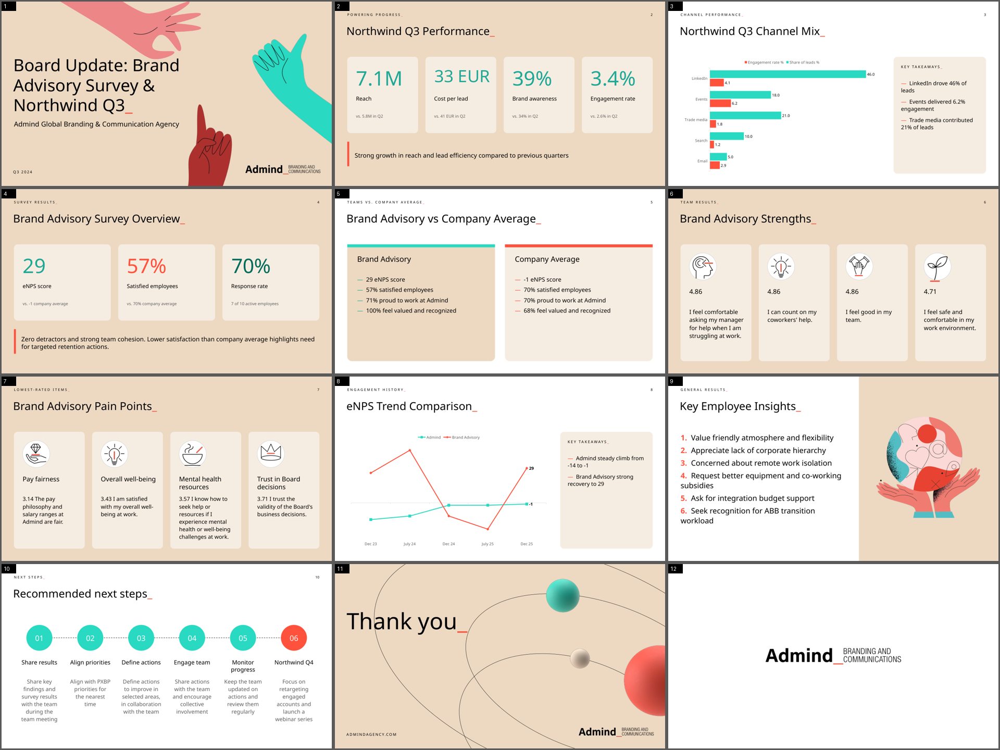

# Admind Deck Builder

Turn a brief and a few files into an editable, on-brand PowerPoint in about 10 seconds, using only AI models
running on Admind's own GPU. No prompt or document is ever sent to OpenAI, Anthropic, Google or any other
cloud model.



## What it does

1. A team member opens the web app, writes what the presentation should do ("A 10-slide board update on the
   December survey with three recommended actions") and drops in source material: PDF, Word, PowerPoint,
   Excel/CSV, text or images.
2. A local model (Qwen3.6-35B-A3B, served by vLLM on the RTX 5090) reads the material, plans a storyline and
   writes every slide as structured data.
3. Python code draws the slides into the Admind master template: native editable charts, tables, KPI cards,
   process diagrams, the hands and spheres artwork, coral `_` titles, transitions and entrance animations.
4. The user sees previews, can ask for changes to any single slide ("make it shorter"), and downloads the
   `.pptx`. Numbers that do not appear in the sources are flagged for review.

## Run it

Requirements: Windows with Docker Desktop and an NVIDIA GPU with 32 GB (RTX 5090), Node.js 20+ for the web app.

```powershell
# 1. Model server + engine (first start downloads ~22 GB of model weights)
cd infra
copy .env.example .env            # set ENGINE_TOKEN_SECRET (any long random string)
docker compose up -d --build
curl http://localhost:8090/api/health

# 2. Web app
cd ..\web
copy .env.example .env.local      # ENGINE_URL=http://localhost:8090, same ENGINE_TOKEN_SECRET, APP_PASSWORD
npm install
npm run dev                       # open http://localhost:3000 and sign in with APP_PASSWORD
```

Without the web app, from a terminal:

```powershell
cd engine
python -m venv .venv; .venv\Scripts\pip install -r requirements.txt     # once
.venv\Scripts\python -m app.cli -p "Summarise this survey for the board" -f "..\Survey Dec 25 - Brand Advisory.pptx" -n 8 -o out
```

**Team deployment (Vercel + Cloudflare tunnel):** [docs/13-deploy-for-team.md](docs/13-deploy-for-team.md).  
Full ops detail: [docs/09-deployment.md](docs/09-deployment.md).

## Documentation

| | |
|---|---|
| [01 Overview](docs/01-overview.md) | Goals, constraints and the key design decisions |
| [02 Architecture](docs/02-architecture.md) | Components, network topology, request lifecycle |
| [03 Generation pipeline](docs/03-generation-pipeline.md) | From files + prompt to a deck, step by step |
| [04 Slide schema](docs/04-slide-schema.md) | The 16 slide types and the JSON contract between model and renderer |
| [05 Rendering](docs/05-rendering.md) | Template, brand system, per-slide drawing code, charts, animations, previews |
| [06 Model serving](docs/06-model-serving.md) | vLLM, why Qwen3.6-35B-A3B NVFP4, measurements, alternatives |
| [07 Engine API](docs/07-engine-api.md) | HTTP endpoints, job storage, authentication |
| [08 Web app](docs/08-web-app.md) | Next.js front end, login, direct-to-engine uploads |
| [09 Deployment](docs/09-deployment.md) | Docker Compose, Cloudflare tunnel, Vercel, configuration, operations |
| [10 Testing](docs/10-testing.md) | Test scripts, scenario runs, quality review workflow |
| [11 Code map](docs/11-code-map.md) | Every file in the repository and what it does |
| [12 Extending](docs/12-extending.md) | New slide types, other brands/templates, other models, known limitations |

## Repository layout

```
engine/   Python service: ingestion, LLM pipeline, PowerPoint renderer, HTTP API (Docker image)
web/      Next.js front end (deployable on Vercel)
infra/    docker-compose stack (vLLM + engine + optional cloudflared), WSL helper scripts
tools/    one-off scripts used to analyse the sample decks and extract the template and artwork
docs/     this documentation
*.pptx    the team's sample decks the style was learned from
```
