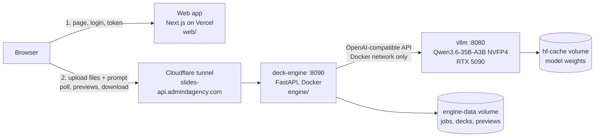

# 02 - Architecture

## Components



| Component | Where | Responsibility |
|---|---|---|
| **Web app** (`web/`) | Vercel (or `npm run dev` locally) | Login page, form, file drop zone, progress, previews, revise box. Mints short-lived tokens. Never receives files. |
| **Cloudflare tunnel** | `Cloudflared` Windows service already on the workstation | Publishes `localhost:8090` as `https://slides-api.admindagency.com` without opening firewall ports. |
| **Engine** (`engine/`) | Docker container `deck-engine` on the workstation | Auth, job queue, file parsing, LLM orchestration, fact check, PowerPoint rendering, LibreOffice previews. |
| **vLLM** | Docker container `vllm` on the workstation | Serves the model on the GPU, batches parallel requests, enforces JSON schemas during decoding. |

Only the engine is exposed to the internet. vLLM has no authentication and must stay local.

## Why the browser talks to the engine directly

Vercel functions accept request bodies up to 4.5 MB, and anything passing through Vercel would mean client
files transit a third-party server. So the web app only hands the browser a **signed token** (valid 2 hours,
HMAC-SHA256 with a secret shared between Vercel and the engine). The browser then uploads straight to the
engine through the tunnel. Vercel sees nothing but the page itself.

## Lifecycle of one request

```mermaid
sequenceDiagram
    participant B as Browser
    participant W as Web app (Vercel)
    participant E as Engine
    participant M as vLLM

    B->>W: POST /api/login {password}
    W-->>B: session cookie (14 days)
    B->>W: GET /api/token
    W-->>B: {engineUrl, token}
    B->>E: GET /api/health
    E->>M: GET /v1/models
    E-->>B: model name, context, vision
    B->>E: POST /api/jobs (multipart: prompt, slide_count, language, files) + Bearer token
    E-->>B: {id}
    Note over E: background task
    E->>E: ingest files (text, tables, chart data, images)
    E->>M: describe images (vision), if any
    E->>M: condense, only if sources exceed the context
    E->>M: outline (JSON schema, slide count enforced)
    E->>M: N slide contents in parallel (one JSON schema per slide type)
    E->>E: normalise deck, fact check, render .pptx, LibreOffice previews
    loop every 1.5 s
        B->>E: GET /api/jobs/{id}
        E-->>B: status, progress, message
    end
    B->>E: GET previews/{n}.png?token=..., deck.pptx?token=...
    B->>E: POST /api/jobs/{id}/revise {slide, instruction}
    E->>M: rewrite one slide (same schema)
    E-->>B: updated slide + warnings; previews re-rendered
```

## Concurrency model

- **vLLM** runs up to 8 sequences at once (`--max-num-seqs=8`). Parallel slide calls are batched on the GPU,
  which is why 8 slides take barely longer than 1.
- **Engine LLM client** caps in-flight requests with a semaphore (`LLM_CONCURRENCY`, 8 in compose).
- **Engine jobs**: at most 2 decks are generated at the same time (`MAX_JOBS_RUNNING` in `main.py`); others wait
  in the queue with status `queued`.
- Rendering and LibreOffice conversion run in a worker thread (`asyncio.to_thread`) so the API stays responsive.

## Data and privacy

| Data | Where it lives | How long |
|---|---|---|
| Uploaded files | `engine-data` Docker volume, `/data/jobs/<id>/input/` | Deleted after 72 h (`JOB_RETENTION_HOURS`) |
| Outline, deck spec, pptx, previews | same job folder | 72 h |
| Prompts and model outputs | job folder; vLLM keeps nothing on disk | 72 h |
| Model weights | `hf-cache` volume | permanent |

Nothing is sent to any external service. The only outbound traffic is the Cloudflare tunnel connection
(carrying the users' own requests) and the one-time model download from Hugging Face.
