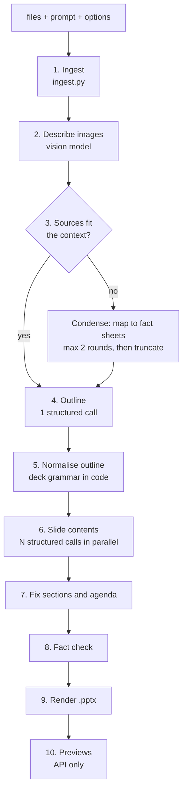

# 03 - Generation pipeline

Entry point: `Pipeline.run()` in `engine/app/pipeline.py`. It is used identically by the HTTP API
(`main.py`) and the command line (`cli.py`).

Files written to the job folder: `outline.json` (after step 5), `deck.json` (after step 8), `deck.pptx`
(step 9), `previews/NN.png` (step 10).

## 1. Ingest (`ingest.py`)

Every file becomes a `Source(name, text, images, kind)`:

| Type | What is extracted |
|---|---|
| `.pdf` | Text per page (PyMuPDF). Pages with under 40 characters (scans, infographics) are rendered to an image for the vision model, max 6. |
| `.docx` | Paragraphs (headings marked `#`) and every table as `a \| b \| c` rows. |
| `.xlsx/.xlsm/.xls`, `.csv` | Each sheet as CSV text. Sheets over 60 rows: first 40 rows plus summary statistics. |
| `.pptx` | Text of every shape (including inside groups), **the data series behind every chart** (`[chart series 'eNPS': Dec 23=-14, ...]`) and table rows. This is how the survey decks' numbers become usable. |
| images | Normalised to JPEG, max 1280 px, sent to the vision model. |
| other (`.txt`, `.md`, `.json`) | Read as UTF-8 text. |

A file that fails to parse does not fail the job; it becomes `[Could not read ...]`.

## 2. Describe images

Up to 8 images are described in parallel by the same model (Qwen3.6 is multimodal), with the instruction
`IMAGE_DESCRIBE` in `prompts.py`: "what it shows, transcribe any visible title, numbers, labels exactly".
The descriptions are appended to the source text, and the image bytes are kept so an `image` slide can show
the original picture.

## 3. Context budget and condensing

Token counts are estimated as `len(text) / 2.8` (`approx_tokens` in `llm.py`; conservative because numbers and
non-English text tokenize densely). Budgets derive from the context size reported by vLLM:

- outline input: `context - 3500` tokens (about 62k with the current 64k context)
- one slide's sources: `min(6000, context - 2600)` tokens

If all sources exceed the outline budget, `_condense` splits them into chunks, asks the model for a "fact
sheet" per chunk in parallel (every number with its label and period, names, quotes, conclusions), joins the
results and repeats. Each chunk's output is capped at `budget / number_of_chunks`, so the result always shrinks.
After 2 rounds the text is truncated. With a 64k context this step is rarely needed; it was essential with the
old 4k model.

## 4. Outline (pass 1)

One call with `prompts.outline_messages()`:

- **System prompt** `HOUSE_STYLE`: who Admind is, how Admind decks read (short headline titles, uppercase
  kicker, numbers as heroes with comparison lines, plain warm language, one idea per slide), professional
  wording, and strict fact rules (only facts from the sources, no stats invented, no data slides without data,
  answer in the language of the request).
- **User message**: the request, the most relevant source chunks, image descriptions, the list of slide types
  with one-line descriptions, and rules: exactly N slides, cover first and closing last, vary the types and
  prefer visual ones, never two bullet slides in a row, every brief must cite the exact facts it will use.
- **Schema**: `outline_model(n)` - an `Outline` whose `slides` list has `min_length = n-1` and
  `max_length = n+1`. vLLM enforces this during decoding, so the model cannot return 5 slides when 8 were asked.
- Sections (chapter dividers) and the agenda are only offered for decks of 12+ slides
  (`SECTIONS_MIN_SLIDES`); short decks are told every slide must carry content.

Each outline entry is `{type, title, brief}` where `brief` says what the slide must say and which numbers it
uses. Temperature 0.5 for some variety in storyline.

## 5. Normalise the outline (`_normalize_outline`)

Small models forget deck grammar, so code enforces it:

- remove any cover / closing / agenda the model added (they are re-added in fixed positions);
- remove sections in short decks, collapse back-to-back sections, drop trailing sections;
- `kpis` / `chart` / `table` without any numbers in the sources become `cards` / `bullets`;
- `image` without uploaded images becomes `bullets`;
- a second consecutive `bullets` slide becomes `cards`;
- cap the length, then prepend the cover (title and subtitle from the outline), an agenda if there are 2+
  sections, and append the closing slide.

## 6. Slide contents (pass 2, parallel)

For each planned slide, `fill()` runs concurrently (`asyncio.gather`):

- **closing** - never generated: fixed content (`Thank you` + `CONTACT_LINE`), so the model cannot invent an
  email address.
- **agenda** - placeholder, filled in step 7.
- everything else - `prompts.slide_messages()` with the deck title, the full list of slide titles (so each
  slide knows the storyline and avoids repeating others), its own brief, and the source chunks most relevant to
  that brief (`_relevant`: keyword-overlap retrieval with a bonus for chunks containing numbers, kept in
  document order). The schema is the slide type's Pydantic model (see [04](04-slide-schema.md)); its field
  descriptions carry the word limits.

`LLM.structured()` validates the reply with Pydantic; on failure it retries twice, appending the validation
error. If a slide still fails, it becomes a bullets slide built from its brief, with a warning - one bad slide
never fails the whole deck.

Thinking mode is disabled (`chat_template_kwargs.enable_thinking=false`): for schema filling it adds latency
without quality gain.

## 7. Sections and agenda (`_fix_sections_and_agenda`)

- A section title that is only a number ("02") is replaced by the next slide's kicker or title.
- Agenda items are set to the final section titles, so the agenda always matches the dividers.
- Section numbers (`01`, `02`) are assigned by the renderer, never by the model.

## 8. Fact check (`fact_check`)

For every slide except dividers and closing:

1. All numbers in the sources and the prompt are collected in every plausible reading (`_numbers`): `4,57`
   as 4.57 (decimal comma), `1,140` and `1 140` as 1140, plain integers and decimals.
2. Numbers on the slide are read the way a reader would (`_claimed_numbers`): `1,140` is one number.
3. Numbers not found in the sources (ignoring 0-12 and 100) produce a warning:
   `Slide 3 (chart): please verify 69 (not in the sources - derived or invented)`.
   Derived values (a growth percentage computed by the model) are legitimately flagged for a human check.
4. A word list (`CRUDE`) flags profanity, e.g. from verbatim employee comments.

Warnings are shown in the web app above the previews and returned by the API and CLI.

## 9. Render

`render_deck()` turns the `DeckSpec` into `deck.pptx` - see [05](05-rendering.md).

## 10. Previews

In the API only, `preview.render_previews()` converts the pptx to PDF with headless LibreOffice and rasterises
each page to `previews/NN.png` (960 px wide) with PyMuPDF.

## Revising a slide

`POST /api/jobs/{id}/revise` calls `Pipeline.revise_slide()`: the current slide JSON, the instruction and the
relevant sources go to the model with the same schema as the slide's type, so the result is the same type with
new content. The slide is fact-checked again, the deck re-rendered and previews regenerated. Changing a slide's
*type* is not supported by revise; edit the spec (`PUT /api/jobs/{id}/spec`) for that.

## Where the time goes (10-slide deck, two input files)

| Step | Seconds |
|---|---|
| ingest | 0.4 |
| outline | 5-6 |
| 9 slide calls in parallel | 3.5-4.5 |
| render | 0.15 |
| LibreOffice previews | ~2.5 |
