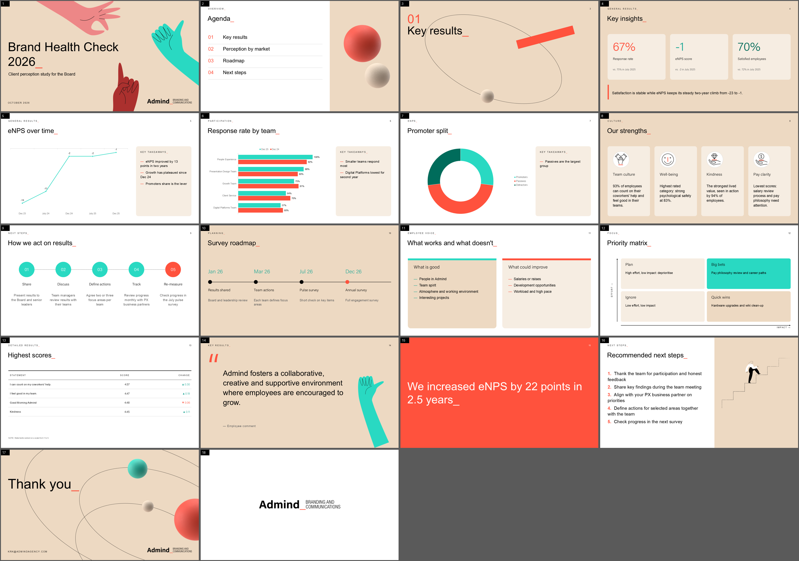

# 04 - Slide schema (the model/renderer contract)

`engine/app/schema.py` defines what the model is allowed to produce. Every model call that returns slide data
is constrained by one of these Pydantic models: vLLM converts the model's JSON Schema into a grammar and only
lets the model emit tokens that keep the output valid. Field `description`s double as instructions (word
limits, what to put where) because they are part of the schema the model sees.

## Deck-level structures

```python
class OutlineSlide(BaseModel):     # pass 1 (outline)
    type: SlideType                # one of the 16 types below
    title: str                     # max 8 words
    brief: str                     # what the slide says + which facts/numbers it uses

class Outline(BaseModel):
    deck_title: str                # max 8 words
    deck_subtitle: str             # max 12 words
    slides: list[OutlineSlide]     # length enforced per request by outline_model(n): n-1 .. n+1

class SlideSpec(BaseModel):        # one rendered slide
    type: SlideType
    content: dict                  # validated by CONTENT_MODELS[type] when generated

class DeckSpec(BaseModel):         # saved as deck.json; input of the renderer
    title: str
    subtitle: str
    slides: list[SlideSpec]
```

Most content models extend `Base`: `title` (max 8 words), `kicker` (1-3 word uppercase eyebrow) and `notes`
(2-4 sentences of speaker notes, written into the PowerPoint notes pane).

## The 16 slide types



| Type | Fields (besides title/kicker/notes) | Rendered as |
|---|---|---|
| `cover` | `title`, `subtitle`, `date_line` (no kicker/notes) | "Cover" layout, cream, three hands, big title with coral `_` |
| `agenda` | `items` 3-6 | numbered list with rules, cream panel with spheres. Items are overwritten with the real section titles. |
| `section` | `title` only (never a number) | "Chapter / Divider": orbit line, tilted coral bar, sphere, `01`/`02` numbering from code |
| `bullets` | `bullets` 2-6 (18 words), `illustration` | numbered coral list; right cream panel with a line illustration (auto-picked if `none`) |
| `kpis` | `kpis` 2-4 of `{value (7 chars), label, context, sentiment}`, `takeaway` | cards with big coloured numbers (teal positive, coral negative, green neutral), coral-bar takeaway |
| `chart` | `chart_type` (bar, column, line, pie, doughnut, stacked_bar), `categories` 2-12, `series` 1-3 `{name, values}`, `unit`, `takeaways` 1-3 | native PowerPoint chart (8.2 in wide) + "Key takeaways" panel |
| `cards` | `cards` 3-4 of `{icon, heading, text}` | icon-in-circle cards; icons are de-duplicated per slide |
| `process` | `steps` 3-6 of `{label, text}` | numbered circles on a dashed line, last step coral |
| `timeline` | `milestones` 3-6 of `{date, label, text}` | horizontal line, dots, teal dates |
| `comparison` | `left`, `right` each `{heading, points 2-5}` | two panels with teal/coral top bars |
| `matrix` | `x_axis`, `y_axis`, `quadrants` 4 of `{heading, text}` | 2x2 grid with arrowed axes, top-right highlighted teal |
| `table` | `columns` 2-5, `rows` 1-6, `note` | minimal table: no grid, black top rule, right-aligned numbers, ▲ teal / ▼ coral |
| `quote` | `quote` (verbatim, max 35 words, professional), `author` | large light text, coral quote mark, teal hand |
| `statement` | `statement` (max 16 words) | "Big statement" layout: full coral slide, white text |
| `image` | `bullets` 1-4, `image_index` | "Content and photo" layout with the uploaded picture |
| `closing` | `title`, `contact` (fixed by code, not generated) | "Thank you" layout with orbits and spheres |

A final "End main" slide (Admind logo) is always appended by the renderer.

## Controlled vocabularies

- `Icon`: lightbulb, teamwork, diamond, plant, crown, magnifier, pencil, bowl, coin, smiley, head, bicycle -
  each maps to a PNG extracted from the sample decks (`engine/assets/catalog.json`, with descriptive tags).
- `Illustration`: none, stairs, people_sphere, hands_heart, documents, eyes.
- `Sentiment`: positive, negative, neutral (drives KPI colour).

Because these are `Literal` types, the model can only choose existing assets.

## Rules encoded in descriptions

Examples of guidance the model receives through the schema itself:

- KPI `value`: "The number with unit, e.g. '67%', '-1', '€2.4M', max 7 chars"
- KPI `context`: "Comparison or context, e.g. 'vs. 72% in July 2025'"
- Chart `categories`: "All categories must share ONE unit and scale - never mix ratings, percentages and counts"
- Card `heading`: "2-4 word label, no numbers"; `text`: "never repeats the heading"
- Section `title`: "Chapter name in words, 2-5 words, never a number"
- Quote: "Verbatim from the sources ... never one with profanity, insults or crude language"
- Cover `date_line`: "the MOST RECENT period in the sources ... never an older comparison period"

## Example `deck.json` fragment

```json
{
  "type": "kpis",
  "content": {
    "title": "Q3 2026 Key Results",
    "kicker": "GENERAL RESULTS",
    "notes": "Reach and leads grew while cost per lead fell...",
    "kpis": [
      {"value": "7.1M", "label": "Reach", "context": "vs. 5.8M in Q2", "sentiment": "positive"},
      {"value": "33 EUR", "label": "Cost per lead", "context": "vs. 41 EUR in Q2", "sentiment": "positive"}
    ],
    "takeaway": "Strong growth in reach and leads with improved efficiency."
  }
}
```

The whole spec can be edited by hand and re-rendered without the model (`PUT /api/jobs/{id}/spec`).
