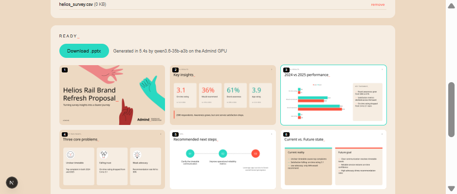
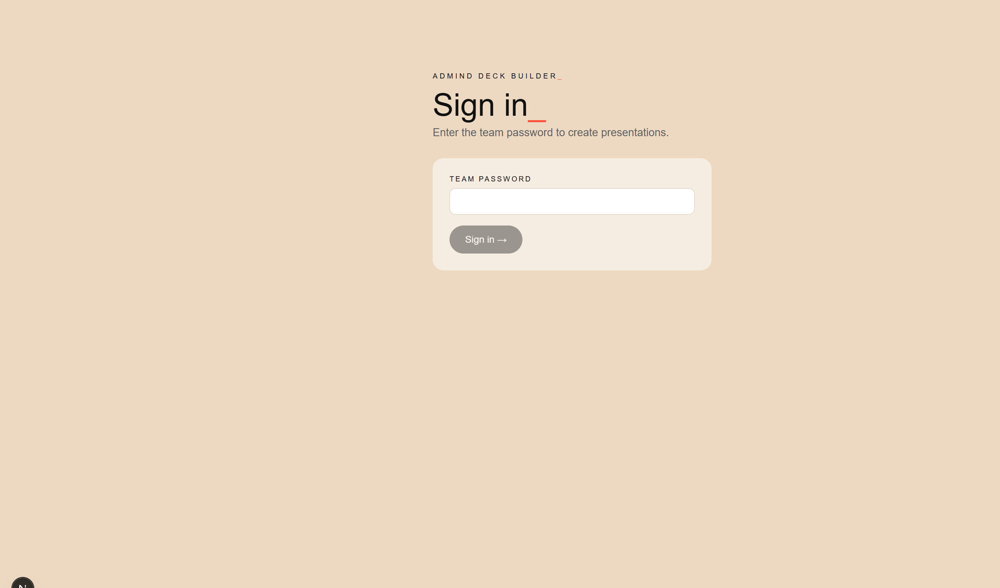

# 08 - Web app

Next.js 15 (App Router) + React 19 in `web/`. No database, no file handling on the server side. Deployable on
Vercel as-is.



## Pages and routes

| Path | File | Purpose |
|---|---|---|
| `/login` | `app/login/page.tsx` | Team password form |
| `/` | `app/page.tsx` | The deck builder (client component) |
| `POST /api/login` | `app/api/login/route.ts` | Checks `APP_PASSWORD`, sets the session cookie; `DELETE` signs out |
| `GET /api/token` | `app/api/token/route.ts` | Returns `{engineUrl, token}` - a 2-hour engine token |
| (all routes) | `middleware.ts` | Redirects to `/login` (pages) or returns 401 (API) without a valid session |

## Sign-in



- The user enters the team password (`APP_PASSWORD`). There is no username.
- `lib/session.ts` creates a cookie `admind_session = <expiry>.<HMAC-SHA256(expiry)>`, keyed with
  `ENGINE_TOKEN_SECRET + APP_PASSWORD`, so changing the password logs everyone out. HttpOnly, SameSite=Lax,
  Secure on HTTPS, valid 14 days.
- Web Crypto is used so the same code runs in the Edge middleware and in the Node route.
- A wrong password is answered after a 600 ms delay to slow down guessing.
- If `APP_PASSWORD` is empty, the gate is disabled (local development).

For company single sign-on, put Cloudflare Access (Microsoft Entra ID / Google Workspace) in front of the web
and engine hostnames and leave `APP_PASSWORD` as a second factor or empty.

## Builder flow (`app/page.tsx`)

1. On load: `GET /api/token`, then `GET {engineUrl}/api/health` to show "Engine online · model · context" or
   "Engine offline".
2. Form: prompt, slide count (4-25), language (same as prompt / English / Polish / German / French), drop zone
   (up to 10 files; pdf, docx, pptx, xlsx, csv, txt, md, images).
3. Generate: `POST {engineUrl}/api/jobs` as multipart **directly from the browser** with
   `Authorization: Bearer <token>`.
4. Poll `GET /api/jobs/{id}` every 1.5 s; progress bar and step message.
5. When done: "Download .pptx" link, generation time and model, fact-check warnings ("Check: ..."), preview grid.
   Image and download URLs carry `?token=` because `` and `<a>` cannot send headers.
6. Revise: click a preview, type an instruction, Apply -> `POST /api/jobs/{id}/revise`; previews reload with a
   `&v=<revision>` cache buster.

## Styling

`app/globals.css` reuses the Admind palette (cream background, light-cream cards, teal/coral accents), the
letter-spaced eyebrow and the coral underscore, so the tool feels like part of the brand.

## Configuration

`web/.env.local` (local) or Vercel project settings:

| Variable | Example | |
|---|---|---|
| `ENGINE_URL` | `https://slides-api.admindagency.com` (local: `http://localhost:8090`) | public engine address used by browsers |
| `ENGINE_TOKEN_SECRET` | long random string | must equal the engine's value |
| `APP_PASSWORD` | team password | empty disables the login |

## Commands

```powershell
cd web
npm install
npm run dev      # http://localhost:3000, hot reload
npm run build    # production build (what Vercel runs)
npm start        # serve the production build locally
```
