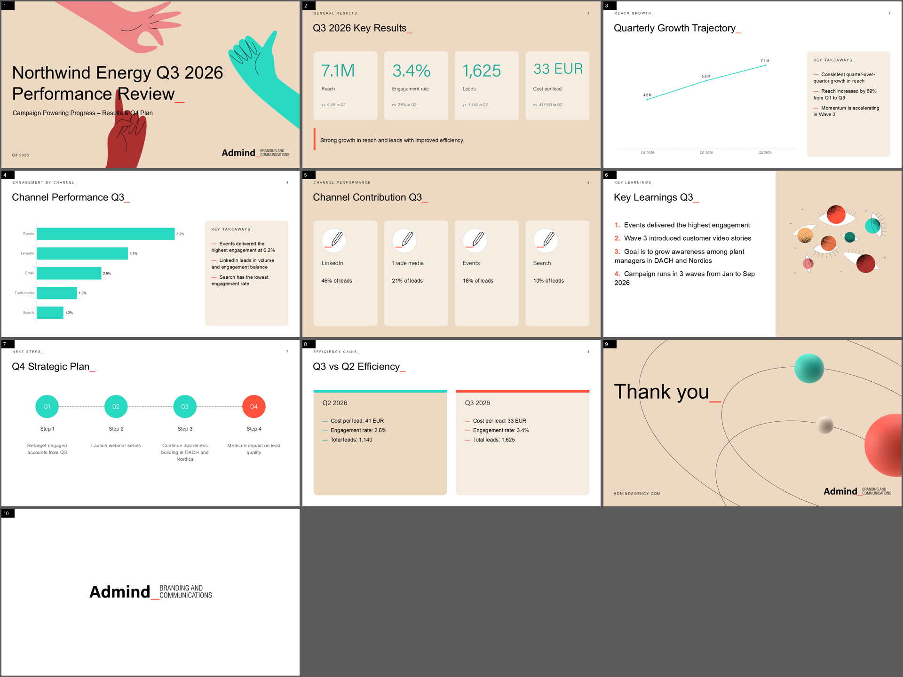

# 10 - Testing

All commands from `engine/` with the virtual environment (`.venv`, Python 3.12, `pip install -r
requirements.txt`). Most scripts need `$env:PYTHONPATH="."`.

## Renderer without a model: `tests/render_fixture.py`

Renders `tests/fixture_deck.json` - a hand-written deck containing every slide type - to
`tests/out/fixture.pptx`. Use it after any change in `render/`: it is instant and deterministic.

```powershell
$env:PYTHONPATH="."; .venv\Scripts\python tests\render_fixture.py
powershell -File ..\tools\render_pptx_windows.ps1 tests\out\fixture.pptx    # PNG per slide via PowerPoint
.venv\Scripts\python ..\tools\contact_sheet.py tests\out\fixture_png        # one overview image
```

Result: [img/all_slide_types.png](img/all_slide_types.png).

## Model checks: `tests/smoke_llm.py`

```powershell
.venv\Scripts\python -m tests.smoke_llm
```

Measures single-stream and 8-parallel tokens/s, checks JSON-schema output (a `Kpis` slide) and vision (draws a
test image with Pillow and asks the model to describe it). Use it after changing the model or vLLM flags.

## Realistic briefs: `tests/run_scenarios.ps1`

Runs three jobs in parallel through the CLI and exports contact sheets:

| Scenario | Input | Slides |
|---|---|---|
| `digital_platforms_14` | `Survey Dec 25 - Digital Platforms.pptx` | 14 |
| `credentials` | `tests/inputs/admind_website.txt` (public website text) | 8 |
| `campaign_q3` | `tests/inputs/campaign_q3.xlsx` (synthetic, made by `tests/make_inputs.py`) | 9 |

```powershell
powershell -ExecutionPolicy Bypass -File tests\run_scenarios.ps1
```

Prints slide types, timings, LLM token stats and fact-check warnings per scenario; review
`data/scenario_*/deck_png/_sheet.png`.



## Full stack: `tests/e2e_api.py`

Exercises the HTTP API exactly like the web app: health, rejection of unauthenticated requests, upload, polling,
download, previews, spec, revise.

```powershell
.venv\Scripts\python tests\e2e_api.py --secret <ENGINE_TOKEN_SECRET> -f "..\Survey Dec 25 - Brand Advisory.pptx" -n 8
.venv\Scripts\python tests\e2e_api.py --url https://slides-api.admindagency.com --key <API key> -f file.pdf
```

Outputs `tests/out/e2e/deck.pptx` and preview PNGs.

## Command line generation: `app/cli.py`

```powershell
.venv\Scripts\python -m app.cli -p "brief" -f a.pptx -f b.xlsx -n 10 -o data\try1 [--lang Polish] [--no-anim] [--base-url http://host:8080/v1]
```

Writes `outline.json`, `deck.json`, `deck.pptx` into the output folder; prints progress, slide types, timings,
LLM stats and warnings.

## Quality review workflow

The renderer was tuned by looking at results, not only by unit tests. The loop used during development:

1. Generate (scenarios or e2e).
2. Export PNGs with real PowerPoint (`tools/render_pptx_windows.ps1`) and build a contact sheet.
3. Look for: text overflow, overlapping artwork, repeated icons, odd chart labels, wrong numbers (compare with
   warnings and sources), monotonous slide types.
4. Fix in code (renderer rules, schema descriptions, prompt rules, outline normalisation), re-render the
   *same* `deck.json` without the model to confirm, then regenerate.

Animations were verified with PowerPoint's object model:

```powershell
$p = New-Object -ComObject PowerPoint.Application
$d = $p.Presentations.Open("...\deck.pptx", $true, $false, $false)
foreach ($s in $d.Slides) { "$($s.SlideIndex): $($s.TimeLine.MainSequence.Count) animations" }
```

## Issues found and fixed this way (examples)

| Symptom | Cause | Fix |
|---|---|---|
| Table borders invisible | border XML after the fill element | `_cell_borders` writes them in schema order |
| Line chart labels "-14." and axis labels at the top | number format, negative values | decimals detected from data, tick labels LOW |
| Fact-check false alarms on CSV data | "1,140" read as 1.14 | separate readings for sources and slides |
| 6 slides instead of 8 | model ignored the count; cleanup removed dividers | schema-enforced length, no dividers offered in short decks |
| Agenda "01 / 02 / 03" | dividers titled with numbers | numbering in code, titles repaired from the next slide |
| Same icon on every card | model repeats choices | `distinct_icons` |
| Cover subtitle under the hand | long titles | narrower title box, finger moved |
| Crude employee quote | verbatim comment chosen | schema + house-style rule, `CRUDE` warning |
